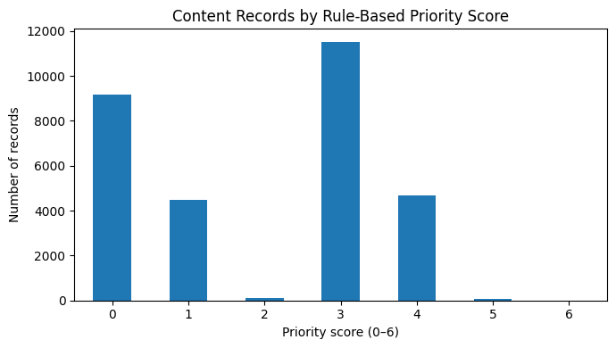
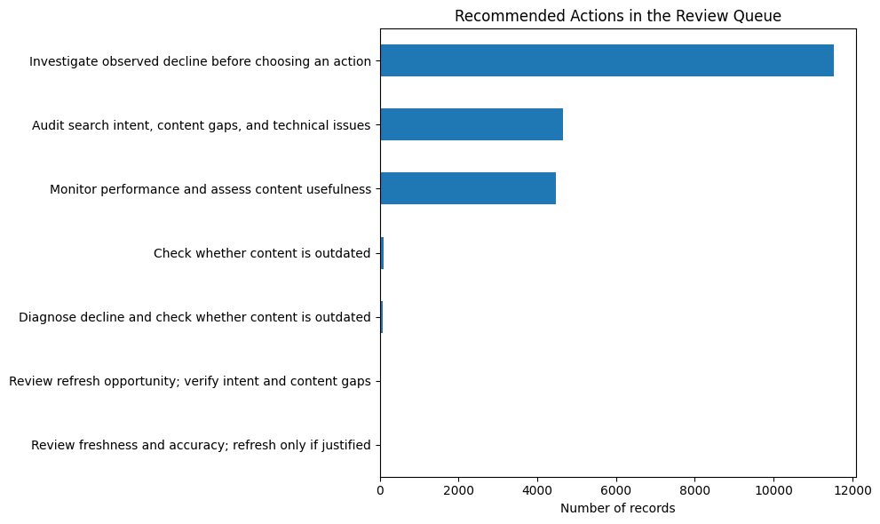

# Prioritizing Declining Content for Human Review: A FlyRank Case Study

## Abstract

Can historical content and search-demand characteristics help FlyRank analysts prioritize pages for human review when search performance declines? This case study uses an anonymized dataset of 30,000 content records, with an initial exploratory analysis showing that 54.21% of records were labeled as declining. I compared a reduced-feature Decision Tree with a majority-class baseline using a client-grouped holdout split, then developed a transparent, rule-based review queue using observed decline, content freshness, and search demand. The Decision Tree achieved 59.81% test accuracy, below the baseline's 61.69%, while its ROC-AUC of 0.5983 indicated limited ranking ability. These findings support cautious, human-led triage and further validation rather than automated content changes or claims that refreshing a page will recover traffic.

## 1. Introduction and Problem

Content teams need a practical way to decide which pages to investigate when search performance changes. Reviewing every page with equal priority can make it difficult to focus limited analyst time on records that have stronger observable reasons for investigation.

This case study grew from the FlyRank content-decline analysis. In the initial exploratory work, 54.21% of the 30,000 records were labeled as declining. This pattern motivated the following research question:

**Can historical content characteristics and search-demand measures help prioritize pages for human review, and does a reduced-feature machine-learning model rank declining pages more effectively than a simple baseline?**

The analysis compares a reduced-feature Decision Tree with a majority-class baseline, using a client-grouped holdout split to reduce the risk of evaluating the model on clients seen during training. It also creates a transparent, rule-based review queue to translate observable signals into practical recommendations.

The intended outcome is decision support for SEO analysts. The model does not make content changes automatically. The analysis also does not establish why a page declined, predict future search performance, or demonstrate that updating a page will recover traffic.

## 2. Data

### Dataset and scope

The analysis uses the anonymized content dataset from the public FlyRank ML internship starter repository:

[FlyRank ML internship starter dataset](https://github.com/flyrank-bih/flyrank-ml-internship-starter)

The dataset contains **30,000 content records and 44 columns**, representing content characteristics, search-demand information, and performance-related fields. The records cover 32 unique clients and 30,000 unique content identifiers.

The initial exploratory analysis found that 16,262 records, or approximately 54.21% of the dataset, had a `trend_direction` label of `down`.

### Features

The classification experiment uses nine content and search-demand features:

- `search_volume`
- `competition`
- `cpc`
- `word_count`
- `content_age_days`
- `days_since_last_update`
- `content_type`
- `main_intent`
- `competition_level`

These features represent search demand, competition, content length, freshness, and content characteristics.

### Target definition and exclusions

For the binary classification experiment, `trend_direction` was converted into a binary target:

- `down` → 1, representing an observed decline.
- `up` and `stable` → 0, representing records not labeled as declining.
- `new` and `flat` → excluded from this binary experiment.

This left 26,612 records for modeling, with 3,388 records excluded.

Performance-related fields such as `impressions_last_30d`, `impressions_prev_30d`, and `trend_pct` were excluded from the model features to avoid target leakage. Client identifiers were used to form the grouped train-test split, not as predictive features.

## 3. Methodology

### Train-test strategy

The data was divided using `GroupShuffleSplit` with a test size of 20% and a random seed of 42. Grouping by client was intended to prevent records from the same client appearing in both training and test sets.

The resulting split contained:

- Training records: 21,514
- Test records: 5,098
- Training clients: 24
- Test clients: 7
- Client overlap between training and test sets: 0

The test set's observed decline rate was 61.69%. This base rate is important when interpreting the model's performance.

### Decision Tree model

A Decision Tree classifier was trained using the nine selected features. The preprocessing pipeline included imputation for missing values and one-hot encoding for categorical features.

The classifier used the following configuration:

- Maximum tree depth: 4
- Minimum samples per leaf: 50
- Class weighting: balanced
- Random seed: 42

These settings were chosen to keep the model relatively constrained and make the experiment easier to inspect. They do not guarantee that the model generalizes well to other datasets or future periods.

### Baseline and evaluation metrics

The Decision Tree was compared with a simple majority-class baseline. The baseline predicts the majority class in the training data. Constant baseline scores were also used for ROC-AUC and average-precision comparisons.

The experiment evaluated:

- **Accuracy:** the proportion of test predictions that were correct.
- **ROC-AUC:** how well model scores distinguish declining from non-declining records across thresholds.
- **Average precision:** a ranking metric that summarizes precision and recall behavior for the positive class.

Accuracy alone can be misleading when classes are imbalanced. Ranking metrics provide additional context, although they do not establish that a model is useful in an operational workflow.

## 4. Results

### Model performance

| Metric | Decision Tree | Majority-class baseline |
|---|---:|---:|
| Test accuracy | 59.81% | 61.69% |
| ROC-AUC | 0.5983 | 0.5000 |
| Average precision | 0.6760 | 0.6169 |

The Decision Tree achieved 59.81% test accuracy, approximately 1.88 percentage points below the majority-class baseline's 61.69%.

The model's ROC-AUC of 0.5983 suggests limited ability to distinguish declining from non-declining records using the selected features. Its average precision was 0.6760, compared with 0.6169 for the constant-score baseline.

The baseline's ROC-AUC of 0.5000 and average precision of 0.6169 reflect its constant scores: it cannot rank individual records differently, and its average precision equals the positive-class prevalence in the test set. These baseline ranking metrics should therefore be interpreted as reference values rather than evidence of a competitive ranking system.

**The main result is not that the Decision Tree outperformed the baseline on every measure. It did not.** Instead, the experiment shows that the selected features and constrained model provided limited predictive separation, while reinforcing the need to evaluate a proposed decision-support tool against a simple alternative.

### Model accuracy comparison

The chart compares test accuracy for the Decision Tree and majority-class baseline. The baseline has higher accuracy, so the current model should not be presented as an accuracy improvement.

### Rule-based review queue

A separate rule-based approach was created to make the review process more transparent. It assigns points using three observable signals:

- Observed decline: 3 points when `trend_direction` is `down`.
- Stale content: 2 points when `days_since_last_update` is at least 180.
- Search demand: 1 point when `search_volume` is at least 20.

The resulting priority score ranges from 0 to 6. Records with scores above zero were included in the review queue and sorted by priority score, followed by search volume.

The queue contained 20,825 of the 30,000 records, approximately 69.42% of the dataset. Five records received a score of 6, and 82 records received scores of 5 or 6.

These thresholds are transparent working rules, not validated optimal cutoffs. The queue is a way to structure human review, not a proven method for improving search performance.

### Priority-score distribution

The priority-score distribution shows how many records fall into each score category. A large queue may still be difficult for a team to process, so the thresholds and resulting workload should be reviewed with actual analyst capacity in mind.

## 5. Limitations and Honest Framing

Several limitations affect how these findings should be used.

**Limited predictive performance.** The Decision Tree's test accuracy was lower than the majority-class baseline. Its ROC-AUC also indicates only limited ranking ability. Further feature analysis, validation, and comparisons are needed before considering deployment.

**Limited client coverage in the test set.** The test set included seven clients. Although the grouped split prevented client overlap, results from a limited number of clients may not represent all clients or future periods.

**Observed labels are not causal explanations.** A `down` label indicates an observed decline in the dataset. It does not explain whether the decline was caused by content quality, technical issues, competition, seasonality, search-intent changes, or other factors.

**The experiment is not a forecasting system.** The results do not demonstrate that a page currently labeled as declining will continue to decline.

**A content refresh is not a guaranteed solution.** The analysis does not measure the causal effect of updating content. A refresh should only be considered after investigating the page's context and identifying a justified action.

**Rule thresholds are provisional.** The priority score uses simple, explicit cutoffs. These rules have not been validated against analyst decisions, recovery outcomes, or measured business impact.

**Data scope and representativeness.** The analysis relies on the supplied anonymized dataset. Its results may not transfer to other datasets, clients, industries, or time periods.

For these reasons, the findings should be treated as exploratory and decision-support oriented. They do not justify automatic content updates or claims of recovered traffic.

## 6. Ranked Recommendations and Practical Playbook

The following playbook turns the analysis into a cautious review process.

### Priority 1: Investigate observed declines

Start by reviewing pages labeled as declining, especially when the rule-based score is high. Confirm the performance pattern in the relevant reporting tools and check whether the change is meaningful for the page and its context.

**Suggested action:** Investigate the observed decline before choosing a remedy.

### Priority 2: Review stale content with meaningful search demand

Pages that have not been updated for at least 180 days and have search volume of at least 20 receive additional priority points. These signals can help surface pages for closer examination.

**Suggested action:** Check whether the information is outdated, inaccurate, incomplete, or no longer aligned with the page's purpose. Do not assume that age alone means a refresh is necessary.

### Priority 3: Audit search intent, content gaps, and technical issues

For pages selected for review, analysts should investigate whether the content answers the relevant search intent and whether there are identifiable quality or technical issues.

**Suggested action:** Compare the page's purpose and content with current user needs, and investigate technical factors before making changes.

### Priority 4: Monitor pages without a clear reason to change

Some pages may show fluctuations without a clear actionable problem. Unnecessary changes could introduce risk without a demonstrated benefit.

**Suggested action:** Monitor performance and assess content usefulness before deciding whether intervention is warranted.

### Priority 5: Validate the playbook before operational use

The rule-based queue and model should be assessed with analysts before becoming part of a routine workflow. Useful next steps include measuring how many flagged pages analysts find actionable, checking how manageable the queue is, and validating the rules on additional clients and later time periods.

**Suggested action:** Treat the queue as a prioritization aid and refine it using documented human feedback and future validation.

### Recommended actions distribution

The chart summarizes the recommended-action categories generated by the notebook. These are rule-generated suggestions, not confirmed outcomes or measured improvements.

## 7. Reproducibility

The analysis was conducted in Python using pandas for data preparation, scikit-learn for model training and evaluation, and Matplotlib for visualization. The dataset was loaded from the public FlyRank ML internship starter repository.

A fixed random seed (`42`) was used for the grouped train-test split and Decision Tree model to support repeatability. The classification experiment used nine content and search-demand features. Records labeled `new` and `flat` were excluded, and client identifiers were used for grouping rather than as predictive features.

The Decision Tree was evaluated against a majority-class baseline using accuracy, ROC-AUC, and average precision. The rule-based review queue used explicit thresholds for observed decline, time since last update, and search volume.

The accompanying notebook contains the data preparation, model evaluation, rule-based prioritization, and chart-generation steps. The charts referenced in this paper should be included in the published `assets` directory.

Reproduction requires access to the source dataset and the notebook's Python dependencies. Results may vary if the source data or software environment changes.

## 8. Acknowledgments & Data Credit

This work was completed as part of the FlyRank Machine Learning internship. Dataset credit goes to [FlyRank](https://flyrank.ai) and the [public FlyRank ML internship starter dataset repository](https://github.com/flyrank-bih/flyrank-ml-internship-starter).

This case study uses anonymized content records and presents aggregate findings to support analysis and human-led decision-making.

---

*This case study is an exploratory analysis for educational and decision-support purposes. It does not establish causal effects or guarantee improvements in search performance.*
